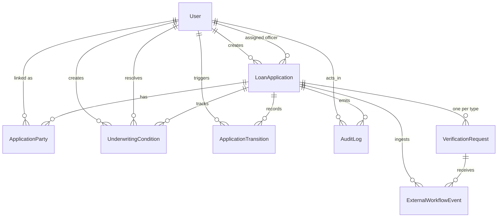

# Domain Model

The source of truth is `prisma/schema.prisma`: 8 models and 9 enums. The datasource block has no `url` (`:5-7`), because Prisma 7 reads it from `prisma.config.ts:10-12`.

## Entities

- **`User`** (`prisma/schema.prisma:73-87`). `email @unique` and a single `role` (no multi-role users). Created only by the seed. Read by `userRepository` (`src/repositories/user-repository.ts`).
- **`LoanApplication`** (`:89-116`). The aggregate root.
  - `publicId @unique` (`:91`) is the external key used in every URL.
  - `stage` defaults to `INTAKE`, `decisionOutcome` defaults to `PENDING`.
  - Five fact timestamps (`intakeCompletedAt`, `approvedAt`, `deniedAt`, `disbursedAt`, `servicingHandedOffAt`, `:99-103`) are the inputs the stage is derived from.
  - `stateVersion` (`:98`) is incremented on every stage change (`src/services/application-command-service.ts:129-131`) and sent to the client, but **never compared** anywhere. It is a version counter, not an optimistic lock.
  - `requestedAmount` is `Decimal(12,2)`.
- **`ApplicationParty`** (`:118-134`). `PRIMARY` or `CO_APPLICANT`. `userId` is nullable (`:121`), so a party can be a person with no account. This is the borrower ownership link used by the visibility filter. Indexed on `userId` (`:133`). There is no unique constraint on `(applicationId, role)`, so nothing in the database prevents two `PRIMARY` parties.
- **`VerificationRequest`** (`:136-153`). `@@unique([applicationId, type])` (`:152`), so there is at most one row per verification type per application. `providerSequence` defaults to 0 (`:142`). That column is the stale-event high-water mark.
- **`UnderwritingCondition`** (`:155-172`). Status is `OPEN`, `SATISFIED`, `WAIVED`, or `FAILED`. It has `createdById` (required) and `resolvedById` (optional).
- **`ApplicationTransition`** (`:174-188`). Append-only `fromStage` to `toStage` with a reason. `triggeredById` is nullable, and `triggeredBySystem` is a boolean.
- **`ExternalWorkflowEvent`** (`:190-207`). Every provider event is stored, applied or not. `appliedToWorkflow` and `receivedOutOfOrder` record the outcome of the sequence check.
- **`AuditLog`** (`:209-223`). Generic `action`, `entityType`, `entityId`, `summary`, and `metadata`. `applicationId` is nullable.

## How `stage` is derived

`reconcileWorkflow(snapshot)` (`src/services/workflow-reconciliation-service.ts:47-137`) is an ordered rule list. The **first** rule that matches wins:

| # | Condition | Result stage | Lines |
| --- | --- | --- | --- |
| 1 | `decisionOutcome === "DECLINED"` or `deniedAt` set | `DENIED` | `:48-53` |
| 2 | `servicingHandedOffAt` set | `SERVICING_HANDOFF` | `:55-60` |
| 3 | `disbursedAt` set | `DISBURSEMENT` | `:62-67` |
| 4 | `intakeCompletedAt` null | `INTAKE` | `:69-74` |
| 5 | any verification `FAILED`, or any of `CREDIT_PULL` / `DOCUMENT_CHECK` / `EMPLOYMENT_CHECK` missing or not `PASSED` | `VERIFICATION` | `:76-95` |
| 6 | `decisionOutcome` is `PENDING` or `REFER` | `CREDIT_DECISIONING` | `:97-105` |
| 7 | any condition `FAILED` | `CONDITIONS` | `:107-113` |
| 8 | any condition `OPEN` | `CONDITIONS` | `:115-124` |
| 9 | `decisionOutcome === "APPROVED"` or `approvedAt` set | `APPROVED` | `:126-131` |
| 10 | otherwise | keep `currentStage` | `:133-136` |

Consequences you can read straight from the order:

- **Denial outranks funding.** Rule 1 comes before rules 2 and 3. If `decisionOutcome` becomes `DECLINED` after disbursement, the file reconciles to `DENIED`. `recordDecision()` only refuses when the reconciled stage is `VERIFICATION` (`application-command-service.ts:408-410`), so an underwriter **can** decline a funded or handed-off loan, and the stage will flip to `DENIED`.
- **Decisions are accepted before submission.** At `INTAKE` (rule 4), `recordDecision`'s guard does not fire, because the stage is `INTAKE`, not `VERIFICATION`. An `APPROVED` decision recorded during intake persists. Once verifications pass, rule 6 is skipped and the file goes straight to `APPROVED` or `CONDITIONS` with no `CREDIT_DECISIONING` stop.
- **Funding freezes verification.** After `disbursedAt` is set, a late `FAILED` verification event cannot pull the file back, because rule 3 wins first.
- **`WITHDRAWN` is unreachable.** No rule returns it.

## Invariants: where each is enforced

| Invariant | DB | Code |
| --- | --- | --- |
| One verification per type | `@@unique([applicationId, type])` | `createVerificationRequest` uses `upsert` (`src/repositories/application-repository.ts:166-181`) |
| `publicId` unique | `@unique` | random `APP-1000`..`APP-9998` (`src/lib/utils/public-id.ts:12`); no retry |
| Stage matches facts | none | only via `reconcileAndPersistStage` |
| Submit only from `INTAKE` | none | `assertCanSubmitApplication` (`workflow-reconciliation-service.ts:139-143`) against the stored stage |
| Disburse only when `APPROVED` | none | `assertCanDisburse` (`:145-149`) against a fresh reconcile (`application-command-service.ts:545-551`) |
| Hand-off only from `DISBURSEMENT` | none | stored-stage check (`:578-580`) |
| Event type matches verification type | none | **not enforced**. `externalEventSchema` accepts `type: "CREDIT_PULL"` with `eventType: "EMPLOYMENT_RESULT"` |
| Conditions resolved once | none | **not enforced**. `resolveCondition` never checks the current status |

## Senior review findings

1. **`publicId` collisions become 500s.** `randomInt(1000, 9999)` (`public-id.ts:12`) gives 8,999 values. The unique index catches a collision, but `createApplication` does not retry, and Prisma's P2002 is not an `AppError`, so the route returns 500 "Internal server error." By the birthday bound, a collision is more likely than not after roughly 110 applications. The seed's `APP-1001` is in the same range.
2. **Audit `entityId` is inconsistent.** Runtime logs use the internal cuid (`application-command-service.ts:98`). The seed uses the public id `"APP-1001"` (`prisma/seed.ts:181`, `:188`). A query for "all audit rows for entity X" cannot use one key for both.
3. **The decision `reason` is overwritten.** `recordDecision` writes `stageReason: input.reason` (`application-command-service.ts:419`). Then `reconcileAndPersistStage` sees `evaluation.reason !== aggregate.stageReason` (`:120`) and overwrites it with the reconciler's text. The underwriter's reason survives only in the audit log's `metadata.reason` (`:429-431`).

## Exercises

1. **Goal:** Predict the stage of `APP-1001` after its last `OPEN` condition is marked `SATISFIED`.
   **Check:** Walk the rule table with the seed's facts (`prisma/seed.ts:77-152`). Rules 1-6 do not match. Rule 7 does not match, because no condition is `FAILED`. Rule 8 does not match, because nothing is `OPEN`. Rule 9 matches, so the answer is `APPROVED`.
2. **Goal:** Find the column that looks like optimistic concurrency but is not.
   **Check:** `stateVersion`. Search for it in `src/`. It is written at `application-command-service.ts:129-131`, presented at `src/lib/presenters/application-presenters.ts:71`, and typed in `src/hooks/use-application-detail.ts:23`. It is never used in a `where`.
3. **Goal:** Explain why `ExternalWorkflowEvent.verificationRequestId` is nullable when the code always sets it.
   **Check:** The schema allows null (`prisma/schema.prisma:193`). `ingestExternalVerificationEvent` always resolves or creates a verification row first (`application-command-service.ts:321-344`). The seed's event (`prisma/seed.ts:196-210`) omits it, so that row is the null case.
